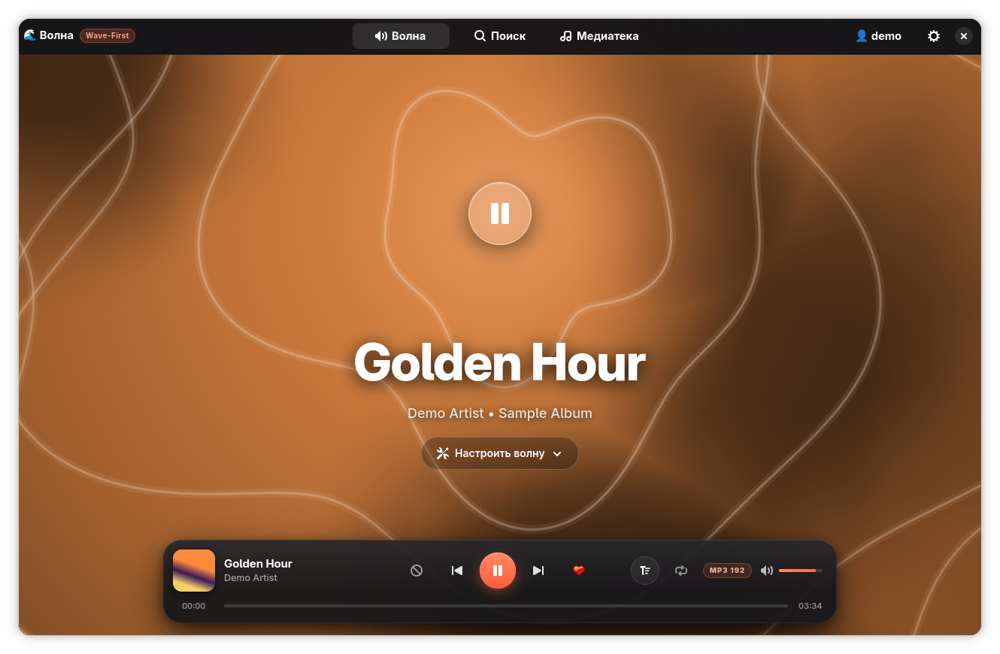
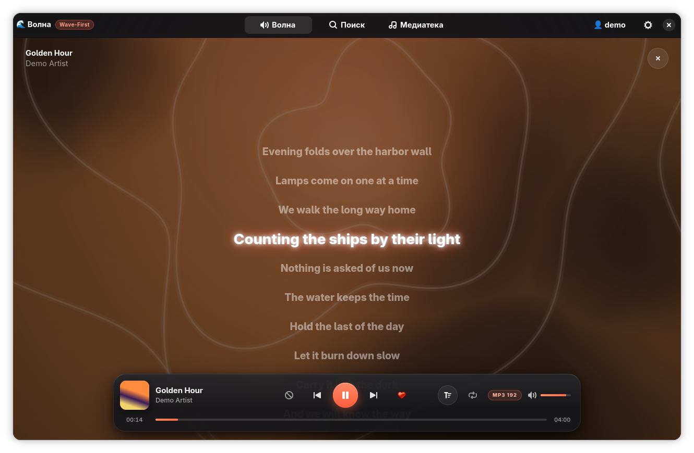

# 🌊 Волна (Volna)

> **Лёгкий нативный плеер Яндекс Музыки для Linux на Rust, GTK4 / Libadwaita и GStreamer.**
> Альтернатива официальному Electron-клиенту: свой интерфейс, своя отрисовка, без встроенного браузера.

[](https://www.gnu.org/licenses/gpl-3.0)
[](https://www.rust-lang.org/)
[](https://gnome.pages.gitlab.gnome.org/libadwaita/)

<p align="center">
  
  
</p>
<p align="center"><sub>Скриншоты сделаны в демо-режиме: вымышленный трек, без аккаунта и сети.</sub></p>

---

## 🎯 Зачем этот проект?

Официальный десктопный клиент Яндекс Музыки построен на **Electron** (Chromium + Node.js) и занимает сотни мегабайт памяти уже в простое.

**Волна** написана с нуля на **Rust** с нативным интерфейсом **GTK4 / Libadwaita**:
- 🚀 **Память:** около **140 МБ** (PSS) во время воспроизведения с открытым экраном Волны, включая драйвер видеокарты.
- 🔋 **Нагрузка:** анимированный фон Волны рисует видеокарта (шейдер OpenGL), процессор только передаёт несколько чисел за кадр.
- 🎨 **Нативный вид:** тёмная тема Libadwaita, Wayland и X11.
- ⌨️ **MPRIS2:** медиа-клавиши, виджеты рабочего стола (KDE, GNOME, Waybar), экран блокировки.

---

## ✨ Возможности

- [x] **Волна (Ротор):** бесконечный персональный поток с реакциями (❤️ лайк, 💔 дизлайк, ⏭ пропуск). Волну можно запустить по артисту или треку; тип Волны виден плашкой сверху. Один и тот же трек из разных альбомов в очередь дважды не попадает.
- [x] **Настройка Волны:** фильтры по настроению, характеру и языку.
- [x] **Живой фон:** заливка цветом трека (по обложке), свечение у кнопки Play, текучие нити и плывущие тёмные пятна; нити пульсируют в такт басу (анализ спектра 40–150 Гц через GStreamer).
- [x] **Коллекция и плейлисты:** «Мне нравится», свои и кураторские плейлисты, любимые альбомы.
- [x] **Поиск:** результаты по мере ввода, раздел «Все» с верхом выдачи, история открытых результатов.
- [x] **Тексты песен:** синхронизированный текст с плавной прокруткой — активная строка всегда по центру, клик по строке перематывает трек к ней, отсчёт 3…2…1 перед первой строкой. Приоритет у текста с таймингами: Яндекс → LRCLIB (точное совпадение, затем поиск). Обычный текст — только если таймингов нигде нет.
- [x] **Плеер:** полоска загрузки потока на шкале перемотки, повтор (выключен / один трек / вся очередь; в Волне без «всей очереди»), реальный формат потока в плашке, значок **E** у треков с ненормативной лексикой.
- [x] **Качество звука:** MP3 в максимальном битрейте, который Яндекс отдаёт сторонним клиентам (сейчас до 192 кбит/с; lossless недоступен).
- [x] **Справка об исполнителе и альбоме:** Википедия, Last.fm и Genius (для двух последних нужны ключи в настройках), перевод английского текста на русский.
- [x] **Навигация:** клик по обложке, названию или исполнителю в плеере открывает альбом, трек или артиста; в подписях страниц — ссылки.
- [x] **Последний трек:** после перезапуска в плеере стоит последний проигранный трек.

---

## 🏛 Архитектура проекта

- **`src/api/`** — асинхронный клиент Яндекс Музыки (`reqwest`, `serde`):
  - `client.rs` — Ротор, треки, поиск, обратная связь станции, прямые ссылки на поток (подпись MD5 с публичной солью из [MarshalX/yandex-music-api](https://github.com/MarshalX/yandex-music-api)), тексты песен с запасным источником LRCLIB.
  - `models.rs` — структуры треков, артистов, альбомов, Ротора, разбор LRC.
  - `auth.rs` — токен, качество звука, ключи Genius и Last.fm (`~/.config/volna/config.json`).
  - `history.rs`, `wiki.rs`, `lastfm.rs`, `genius.rs`, `translate.rs` — история поиска, справка, перевод.
- **`src/player/`** — звук на **GStreamer**:
  - `audio.rs` — `gstreamer-play` в режиме загрузки (поток докачивается во временный файл, видно, сколько загружено), анализатор баса на элементе `spectrum`.
  - `manager.rs` — очередь, Волна, повтор, защита от гонок быстрых переключений.
- **`src/ui/`** — интерфейс **Libadwaita / GTK4**:
  - `wave_view.rs` + `wave_gl.rs` — экран Волны; фон — фрагментный шейдер в `GtkGLArea` (OpenGL через EGL).
  - `window.rs` — главное окно, экран текста песни.
  - `floating_island.rs` — плавающий плеер.
  - `search_view.rs`, `library_view.rs`, `collection.rs` — поиск, медиатека, страницы альбомов, плейлистов, артистов и треков.
  - `preferences_dialog.rs`, `auth_dialog.rs` — настройки и вход.
  - `style.css` — оформление.

---

## 🎨 Дизайн и макеты

Интерактивные прототипы лежат в [`mockups/`](mockups/): витрина [`index.html`](mockups/index.html), утверждённый макет [`variant2_fluid.html`](mockups/variant2_fluid.html), скриншоты в [`screenshots/`](mockups/screenshots/).

---

## 🛠 Сборка и запуск

### Системные зависимости (Arch Linux и производные):
```bash
sudo pacman -S gtk4 libadwaita gstreamer gst-plugins-base gst-plugins-good gst-plugins-bad mesa
```
`gst-plugins-good` нужен для анализатора баса (`spectrum`), `mesa` (или другой драйвер OpenGL/EGL) — для фона Волны.

### Сборка из исходников:
```bash
git clone https://github.com/fallkdm/volna.git
cd volna
cargo build --release
```

### Запуск:
```bash
./target/release/volna
```

Демо-режим без аккаунта (для скриншотов и проверки интерфейса): `VOLNA_DEMO=1` (или `2`, `3` — другие цвета), необязательно `VOLNA_DEMO_COVER=путь.jpg`, `VOLNA_DEMO_POS_MS=14000` (позиция для подсветки строки), `VOLNA_DEMO_LYRICS=1` (сразу открыть текст песни). Чтобы демо не трогало настоящие настройки, запускайте с отдельными `XDG_CONFIG_HOME` и `XDG_CACHE_HOME`.

Ярлык и иконка для меню приложений — в [`data/`](data/): `data/applications/io.github.fallkdm.Volna.desktop` и `data/icons/io.github.fallkdm.Volna.svg` (в `Exec` стоит просто `volna`: положите бинарник в `PATH` или впишите полный путь).

Токен авторизации вводится в «Настройках» либо сохраняется в `~/.config/volna/config.json`:
```json
{
  "token": "y0_AgAAAA..."
}
```

---

## ⚖️ Правовая информация

«Волна» — **неофициальный** клиент. Проект не связан с ООО «Яндекс» и не одобрен им; автор не претендует на какие-либо права Яндекса. «Яндекс», «Яндекс Музыка», «Моя волна» и связанные обозначения — товарные знаки их правообладателей, упоминаются только для указания совместимости.

- Приложение не распространяет музыку, обложки и иные материалы Яндекса; всё воспроизводится через личный аккаунт пользователя. Поток на время воспроизведения скачивается во временный файл GStreamer и удаляется им.
- Для работы нужен собственный аккаунт и токен. Используйте приложение в соответствии с условиями сервиса Яндекс Музыки.
- Код приложения Яндекса в проекте не используется; работа идёт через публичный API, известный по открытым библиотекам.
- Ассеты и логотипы Яндекса в репозиторий не включены.
- Программа поставляется «как есть», без каких-либо гарантий.

### Сторонние данные

- **Тексты песен:** [LRCLIB](https://lrclib.net) — открытая база, бесплатный API.
- **Справка об исполнителях и альбомах:** [Википедия](https://www.wikipedia.org) и [Last.fm](https://www.last.fm) — тексты под лицензией CC BY-SA, в приложении под карточкой указан источник со ссылкой; [Genius](https://genius.com) — по API с токеном пользователя.
- **Перевод:** [MyMemory](https://mymemory.translated.net) — бесплатный API с дневным лимитом.

### Сторонние библиотеки

Лицензии всех зависимостей совместимы с GPL-3.0 (проверено по `cargo metadata`): gtk4-rs, libadwaita-rs (MIT), gstreamer-rs, reqwest, serde (MIT / Apache-2.0), tokio (MIT), glow (MIT / Apache-2.0 / Zlib), libloading (ISC), mpris-server (MPL-2.0); остальное — MIT, Apache-2.0, BSD, ISC, Zlib, Unicode-3.0. Полный список — в `Cargo.lock`. Системные библиотеки GTK, Libadwaita и GStreamer (LGPL) подключаются динамически.

## 📄 Лицензия

Проект распространяется под лицензией **GNU General Public License v3.0 (GPL-3.0-only)**. См. файл [LICENSE](LICENSE).
