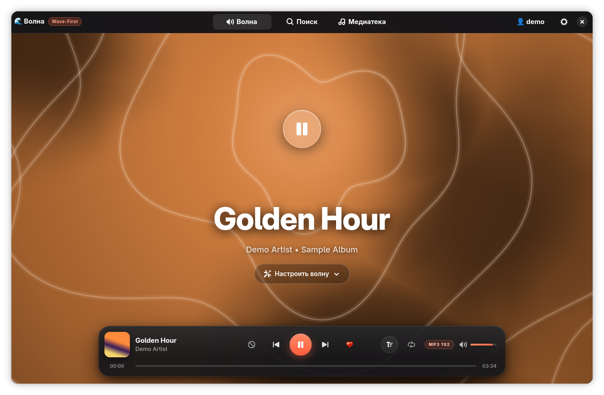
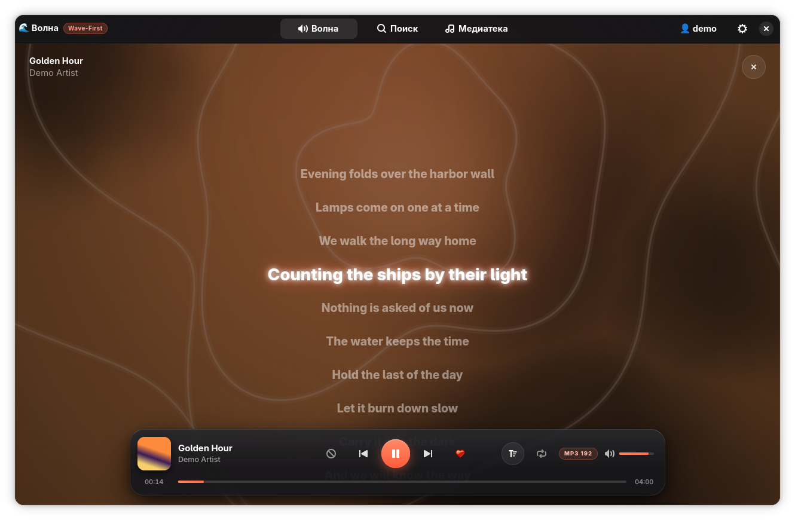

# 🌊 Волна (Volna)

> **Лёгкий нативный хаб музыкальных стриминговых сервисов для Linux: Яндекс Музыка, YouTube Music и VK Музыка на Rust, GTK4 / Libadwaita и GStreamer.**
> Единый интерфейс, чистый звук, аппаратная отрисовка и никакого Electron.

[](https://www.gnu.org/licenses/gpl-3.0)
[](https://www.rust-lang.org/)
[](https://gnome.pages.gitlab.gnome.org/libadwaita/)

<p align="center">
  
  
</p>
<p align="center"><sub>Скриншоты сделаны в демо-режиме: вымышленный трек, без аккаунта и сети.</sub></p>

---

## 🎯 Зачем этот проект?

Официальные десктопные клиенты и веб-версии стриминговых платформ построены на **Electron** (Chromium + Node.js) или открываются во вкладках браузера, потребляя сотни мегабайт и гигабайты оперативной памяти даже в фоновом режиме.

**Волна** объединяет популярные музыкальные сервисы в единый независимый **музыкальный хаб**, написанный с нуля на **Rust** с нативным окружением **GTK4 / Libadwaita**:
- 🚀 **Память:** около **140 МБ** (PSS) при воспроизведении с активным визуализатором Волны, включая видеодрайвер.
- 🔀 **Единый хаб:** быстрое переключение между **Яндекс Музыкой**, **YouTube Music** и **VK Музыкой** на лету без перезапуска приложения и дублирования плееров.
- 🔋 **Энергоэффективность:** анимированный фон Волны считает видеокарта (шейдер OpenGL через EGL), процессор не перегружается рендерингом страниц.
- 🎨 **Нативный дизайн:** адаптивная тёмная тема Libadwaita, поддержка Wayland и X11.
- ⌨️ **Интеграция с системой:** MPRIS2 (медиа-клавиши, виджеты KDE Plasma, GNOME, Waybar, экран блокировки), Discord Rich Presence, управление через Unix-сокет и MCP-сервер.

---

## ✨ Возможности

### 🎛 Музыкальный хаб и провайдеры
- [x] **Быстрое переключение сервисов:** мгновенный переход между Яндекс Музыкой, YouTube Music и VK Музыкой в один клик или через терминал/горячие клавиши.
- [x] **Яндекс Музыка:**
  - Персональный поток «Моя Волна» (Ротор) с реакциями (❤️ лайк, 💔 дизлайк, ⏭ пропуск) и фильтрами настроения, характера и языка.
  - Полная дискография артистов (`direct-albums`) с сортировкой по годам и месяцам релизов.
  - «Живая Аватарка» профиля исполнителя (анимированное видео на фоне шапки).
  - Фоновые превью-клипы и трансляция звука на Яндекс Станцию.
- [x] **YouTube Music:**
  - Прямой стриминг через VisionOS API (мгновенный отклик 100–200 мс, Opus 160 кбит/с, itag 251) с автоматическим обходом недоступных нод GGC.
  - Двухслойные кинематографичные баннеры профилей артистов (Dual-Layer Backdrop с верхним портретным Y-фокусом и плавным 4-сторонним растворением).
  - Полноформатные видеоклипы на всю длину трека синхронно со звуком.
  - Полная медиатека «Мне нравится» через YouTube Data API v3 без обрезания первой страницей.
  - Автоматический импорт сессии из браузеров (Chrome, Chromium, Brave, Edge, Vivaldi с поддержкой KWallet/Secret Service и выбором активного профиля из `Local State`, а также Firefox) с фоновым автообновлением без F12.
- [x] **VK Музыка (ВКонтакте):**
  - Воспроизведение треков пользователя, плейлистов и альбомов.
  - Токенный матчинг и ранжирование артистов в поиске и каталоге.
  - Поддержка `access_key` для защищенных аудиозаписей и обработка капчи через нативный диалог.
  - Безопасное хранение токенов в системном Keyring.

### 🎧 Звук и воспроизведение
- [x] **Движок GStreamer:** двойной независимый слот воспроизведения, программное управление громкостью, предзагрузка (преролл) и бесшовный кроссфейд без сброса системной громкости PipeWire/WirePlumber.
- [x] **Анализатор спектра:** выделение частот баса (40–150 Гц) через GStreamer `spectrum` для физической пульсации нитей визуализатора Волны и анимации питомца.
- [x] **Тексты песен (караоке):** синхронизированные тайминги с автопрокруткой и перемоткой по клику на строку. Приоритет: Яндекс → открытая база LRCLIB (точное совпадение + поиск).
- [x] **Умный кэш:** фоновые клипы сохраняются локально (`~/.cache/volna/clips`, лимит 512 МиБ, LRU-очистка), доступно сохранение треков для офлайн-прослушивания.

### 🖼 Интерфейс и кастомизация
- [x] **Два стиля навигации:** классический верхний бар (`wave`) или боковой сайдбар в стиле Spotify (`spotify`) с кнопкой сворачивания.
- [x] **Два стиля плеера:** парящий остров (`floating`) с индикатором загрузки и форматом потока либо прижатая панель (`dock`).
- [x] **Цветовые акценты темы:** динамический (подстраивается под обложку текущего трека), Spotify Green, Ruby, Sunset, Violet, Ocean, Monochrome.
- [x] **Интерактивный питомец:** анимированный персонаж на панели плеера (Волнёнок, Кот, Слизень), реагирующий на ритм музыки.
- [x] **Справка об артистах и релизах:** статьи из русской Википедии (приоритет через REST API и langlinks), Discogs (CC0), Last.fm и Genius (с автоматической очисткой HTML-тегов).

---

## 🏛 Архитектура проекта

- **`src/api/`** — модули провайдеров и внешних сервисов:
  - `provider.rs`, `provider_manager.rs` — абстракция `MusicProvider` и менеджер переключения хаба.
  - `client.rs` — клиент Яндекс Музыки (Ротор, треки, альбомы, поиск, радио).
  - `ytmusic/` — клиент YouTube Music (InnerTube VisionOS/WEB_REMIX/TVHTML5, YouTube Data API, OAuth Device Flow, парсеры).
  - `vk/` — клиент VK Музыки (API `audio.*`, авторизация, Keyring-токены, капча, каталоги).
  - `browser_cookies.rs` — импорт браузерных сессий (Firefox, Chromium-семейство через KWallet и Secret Service, учёт `Local State`).
  - `history.rs`, `wiki.rs`, `discogs.rs`, `lastfm.rs`, `genius.rs`, `translate.rs` — обогащение данных, биографии и дискографии.
  - `auth.rs` — единая конфигурация (`~/.config/volna/config.json`), потокобезопасная запись с защитой от повреждений.
- **`src/player/`** — аудиодвижок и координация:
  - `audio.rs` — GStreamer-пайплайн софтверной громкости, слоты, кроссфейд, спектральный анализ баса.
  - `manager.rs` — центральный контроллер очереди, треков, фильтров и состояний плеера.
  - `clip.rs`, `clip_telemetry.rs` — управление фоновым видео и клипами.
  - `wave_engine.rs` — логика ротации треков и персональной Волны.
- **`src/ui/`** — нативный интерфейс GTK4 / Libadwaita:
  - `wave_view.rs` + `wave_gl.rs` — экран Волны на фрагментном OpenGL-шейдере.
  - `window.rs` — главное окно, адаптивные отступы, экран текстов песен.
  - `collection.rs`, `library_view.rs`, `search_view.rs` — страницы артистов с фоновыми баннерами, альбомы, плейлисты, поиск.
  - `floating_island.rs` — плавающий плеер и док-панель.
  - `pet.rs` — процедурный питомец на панели плеера.
- **`src/ipc/`** — управление через Unix domain socket (`volna.sock`) и встроенный сервер MCP (`volna mcp`).

---

## 🛠 Сборка и запуск

### Системные зависимости (Arch Linux и производные):
```bash
sudo pacman -S gtk4 libadwaita gstreamer gst-plugins-base gst-plugins-good gst-plugins-bad mesa
```
* `gst-plugins-good` необходим для спектрального анализа баса (`spectrum`).
* `mesa` (или проприетарный видеодрайвер) обеспечивает аппаратное ускорение фона Волны через OpenGL/EGL.

### Установка готового пакета (Arch Linux):
Готовый пакет публикуется в [Releases](https://github.com/fallkdm/volna/releases):
```bash
sudo pacman -U https://github.com/fallkdm/volna/releases/latest/download/volna-x86_64.pkg.tar.zst
```
Сборка локального пакета через `makepkg`:
```bash
cd packaging/arch && makepkg -si
```

### Сборка из исходников:
```bash
git clone -b beta-linux https://github.com/fallkdm/volna.git
cd volna
cargo build --release
./target/release/volna
```

---

## 🔑 Вход в сервисы

### Яндекс Музыка
1. **Через браузер:** нажмите «Получить токен» в окне входа, авторизуйтесь в Яндекс ID и вставьте скопированную адресную строку (`https://music.yandex.ru/#access_token=...`).
2. **По коду устройства:** откройте `ya.ru/device` и введите отображаемый одноразовый код.
3. Токен сохраняется в локальном файле `~/.config/volna/config.json` (права доступа `0600`).

### YouTube Music
1. **Сессия из браузера (рекомендуется):** нажмите «Импортировать» — Волна автоматически расшифрует сессию из Chrome, Chromium, Brave, Edge, Vivaldi (включая KWallet в KDE Plasma) или Firefox, выберет активный профиль и настроит аккаунт. Сессия обновляется автоматически в фоне.
2. **Свой Google OAuth-клиент:** укажите Client ID и Client Secret приложения типа *TV and Limited Input* и подтвердите код на `google.com/device` (refresh-токен продлевается автономно).
3. **Без входа:** Волна, поиск, клипы и страницы артистов доступны в гостевом режиме.

### VK Музыка
1. **По токену:** вставьте токен Kate Mobile / официального VK Android клиента в настройках.
2. **Прямой вход:** введите логин и пароль с поддержкой двухфакторной аутентификации (SMS/Push/Email/2FA-код) и проверкой капчи.
3. Токен сохраняется в системном Keyring ОС (через Secret Service / KWallet) либо в приватном файле `~/.config/volna/vk_token` (`0600`).

---

## ⌨️ Управление из терминала и IPC

Приложение поднимает Unix-сокет (`$XDG_RUNTIME_DIR/volna.sock` или `/tmp/volna.sock`), позволяя управлять плеером из скриптов, статус-баров или ИИ-агентов:

```bash
volna cmd status                       # текущий трек, статус воспроизведения, провайдер
volna cmd switch_provider ytmusic      # переключить сервис: yandex, ytmusic, vk
volna cmd play                         # возобновить воспроизведение
volna cmd pause                        # поставить на паузу
volna cmd next                         # следующий трек
volna cmd prev                         # предыдущий трек
volna cmd filter - not-russian -       # настроить фильтры Волны
volna cmd clip on|off|status           # управление фоновыми клипами
volna mcp                              # запуск MCP сервера (Model Context Protocol)
```

---

## ⚖️ Правовая информация

«Волна» — **независимый неофициальный клиент-хаб**. Проект не связан с правообладателями сервисов, не спонсируется ими и не одобрен ими. Все права на бренды принадлежат их владельцам:
- **Яндекс**, «Яндекс Музыка», «Моя волна» — товарные знаки **ООО «Яндекс»**.
- **YouTube**, «YouTube Music» — товарные знаки **Google LLC / Alphabet Inc.**.
- **ВКонтакте**, «VK», «VK Музыка» — товарные знаки **ООО «В Контакте» / VK Company**.

Названия сторонних сервисов упоминаются исключительно в целях информирования о совместимости программного обеспечения (fair use / номинативное использование).

- **Отсутствие распространения материалов:** приложение не содержит музыки, видеоматериалов или обложек и не хранит их на серверах автора. Все потоки и метаданные запрашиваются напрямую с серверов правообладателей через личные учетные записи пользователей.
- **Хранение данных:** учетные данные, OAuth-токены и сессионные куки хранятся исключительно локально на устройстве пользователя (`~/.config/volna/config.json`, права `0600` или системный Keyring) и передаются строго на официальные эндпоинты соответствующих платформ по защищенным протоколам HTTPS/TLS.
- **Соблюдение правил сервисов:** использование приложения осуществляется пользователем на собственный риск в соответствии с условиями использования соответствующих сервисов.
- Программное обеспечение поставляется «как есть» (AS IS), без каких-либо явных или подразумеваемых гарантий.

---

## 📚 Сторонние данные и лицензии

Проект бережно относится к лицензиям внешних поставщиков метаданных и библиотек:

### Источники метаданных
- **Тексты песен:** [LRCLIB](https://lrclib.net) — открытая база текстов песен с таймингами (Open API).
- **Биографии и справка об артистах:**
  - [Википедия](https://ru.wikipedia.org) — тексты распространяются на условиях свободной лицензии **Creative Commons Attribution-ShareAlike 4.0 International (CC BY-SA 4.0)**. Приоритет отдается русскоязычным статьям; в интерфейсе приводится прямая ссылка на источник и автора.
  - [Discogs](https://www.discogs.com) — дискографии и метаданные музыкальных релизов используются в соответствии с условиями **Creative Commons CC0 1.0 Universal (Public Domain Dedication)**.
  - [Last.fm](https://www.last.fm) — теги и статистика прослушиваний через официальный пользовательский API (**CC BY-SA**).
  - [Genius](https://genius.com) — справочные описания по пользовательскому API с обязательной санитацией HTML-разметки.
- **Перевод текстов:** [MyMemory API](https://mymemory.translated.net).

### Зависимости и библиотеки
Все программные компоненты проекта проверены на совместимость с лицензией **GPL-3.0**:
- **Интерфейс:** `gtk4-rs`, `libadwaita-rs` ([MIT](https://opensource.org/licenses/MIT)), системные библиотеки GTK4 и Libadwaita ([LGPL-2.1+](https://www.gnu.org/licenses/old-licenses/lgpl-2.1.html), динамическая линковка).
- **Мультимедиа:** `gstreamer-rs`, `gstreamer-play-rs` ([MIT / Apache-2.0](https://www.apache.org/licenses/LICENSE-2.0)), системный фреймворк GStreamer ([LGPL-2.1+](https://www.gnu.org/licenses/old-licenses/lgpl-2.1.html)).
- **Асинхронный рантайм и сеть:** `tokio` (MIT), `reqwest` (MIT / Apache-2.0), `rustls` (Apache-2.0 / ISC / MIT).
- **Хранилище и сериализация:** `rusqlite` (MIT, со встроенной SQLite в Public Domain), `serde`, `serde_json` (MIT / Apache-2.0).
- **Криптография и безопасность:** `ring` (OpenSSL / ISC), `aes`, `cbc`, `sha1`, `md-5` (MIT / Apache-2.0), `zeroize` (Apache-2.0 / MIT), `keyring` (MIT / Apache-2.0).
- **Системные интеграции:** `mpris-server` ([MPL-2.0](https://www.mozilla.org/MPL/2.0/)), `glow` (MIT / Apache-2.0 / Zlib), `discord-rich-presence` (MIT), `libc` (MIT / Apache-2.0).

Полное дерево зависимостей зафиксировано в [Cargo.lock](Cargo.lock).

---

## 📄 Лицензия проекта

Проект «Волна» лицензирован под **GNU General Public License v3.0 (GPL-3.0-only)**. Полный текст условий и положений доступен в файле [LICENSE](LICENSE).
